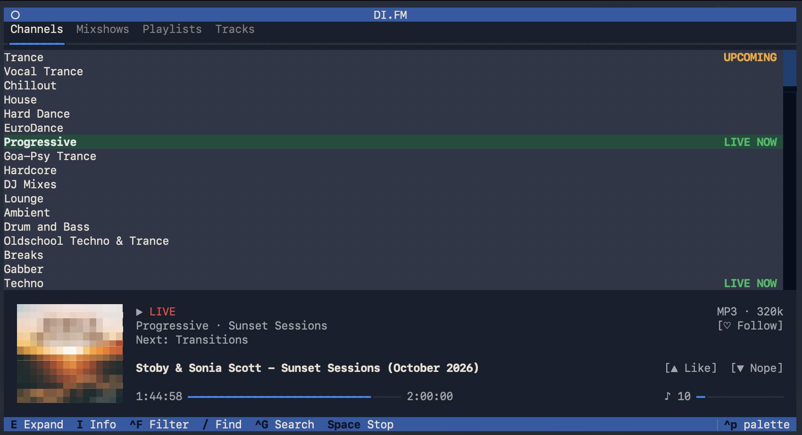
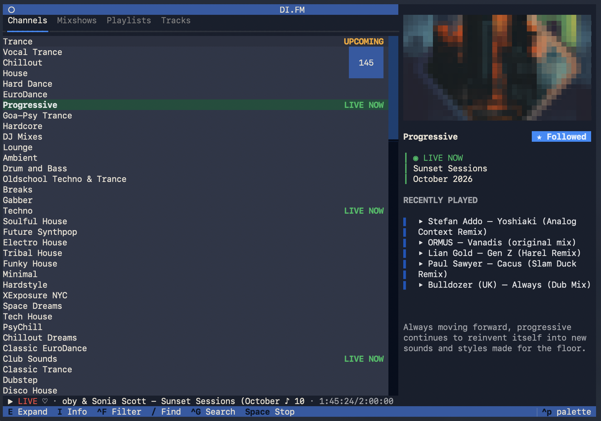
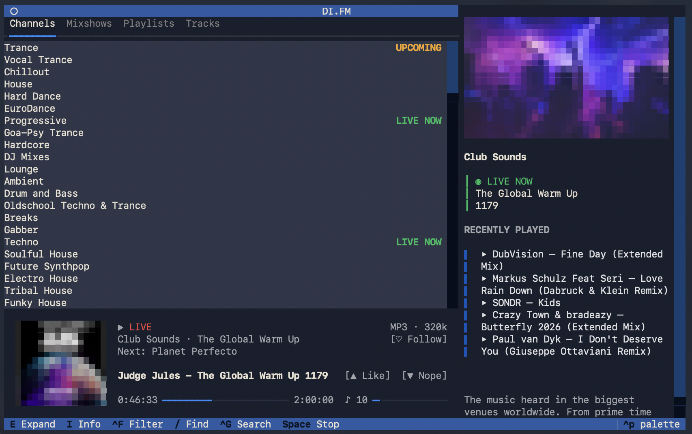
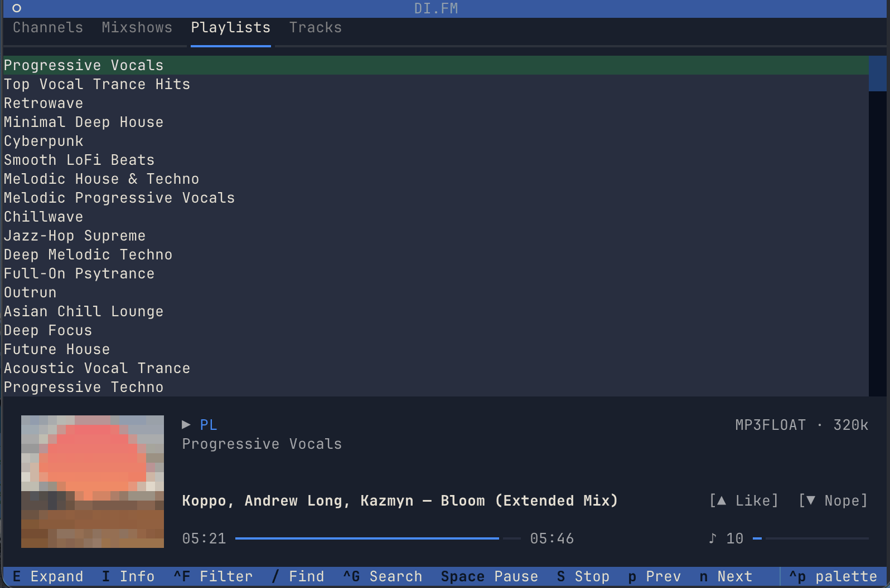
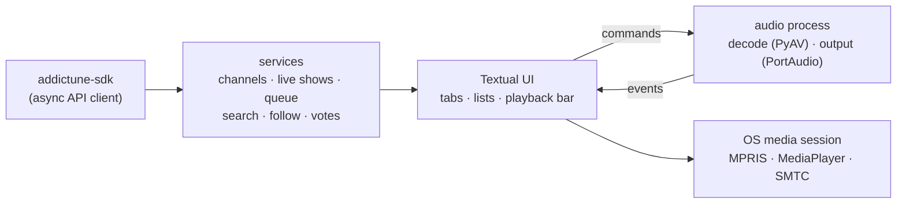

<div align="center">

<picture>
  <source media="(prefers-color-scheme: light)" srcset="docs/assets/logo-light.svg">
  
</picture>

<br>

<h3>A terminal client for DI.FM and other AudioAddict radio networks</h3>

**addictune** is an unofficial **[DI.FM](https://www.di.fm/) client** for your terminal. It also supports the other [AudioAddict](https://www.audioaddict.com/) networks: [RadioTunes](https://www.radiotunes.com/), [ROCKRADIO.COM](https://www.rockradio.com/), [JAZZRADIO.com](https://www.jazzradio.com/), [Classical Radio](https://www.classicalradio.com/) and [ZenRadio](https://www.zenradio.com/).
Browse live channels, DJ mixshows, curated playlists and your liked tracks. Control playback from the keyboard or your system's media controls.

<br>

[](https://github.com/ukw2d/addictune-cli/actions/workflows/ci.yml)
[](https://github.com/ukw2d/addictune-cli/releases)
[](LICENSE)

[](https://www.python.org/)
[](https://textual.textualize.io/)
[](https://docs.astral.sh/uv/)
[](https://docs.astral.sh/ruff/)

[](https://pypi.org/project/addictune-sdk/)

[Install](#-install) · [Features](#-features) · [Keys](#-keyboard-shortcuts) · [How it works](#-how-it-works) · [Contributing](CONTRIBUTING.md)

</div>

---

> [!NOTE]
> **Beta software.** addictune is in beta and under active development. Features and behavior may change between releases.
>
> **Unofficial project.** addictune is not affiliated with, endorsed by or sponsored by AudioAddict, DI.FM, RadioTunes, ROCKRADIO.COM, JAZZRADIO.com, Classical Radio or ZenRadio. All names and trademarks belong to their owners. You need your own AudioAddict account.

<div align="center">

</div>

## ✨ Features

- **Six networks, one client.** Each network has its own colour theme. Switch networks from the command palette.
- **Channels, Mixshows, Playlists, Tracks.** Tabs appear when the active network supports that content. The Tracks tab shows your liked tracks.
- **Live shows.** A `LIVE NOW` badge marks channels with a show on air. The info panel shows current and upcoming shows, plus recently played tracks.
- **Follow and rate.** Follow channels, mixshows, playlists and live shows, and like or dislike tracks from the keyboard.
- **Search and filters.** `/` searches the current list, `Ctrl+G` searches across categories, and `Ctrl+F` opens filter and sort options.
- **Playback controls.** Seek, adjust volume, mute, and skip between tracks. Expand the playback bar to see more detail, including stream format and bitrate.
- **System media controls.** Use media keys and view playback information through MPRIS on Linux, `MediaPlayer` on macOS, and SMTC on Windows.
- **Artwork.** Cover art rendered as pixel art in your terminal.
- **Responsive playback.** Audio runs in a separate process to keep the interface responsive. Interrupted live streams reconnect automatically.
- **Audio settings.** Choose the output device, sample rate and latency without restarting the app.
- **Vim navigation.** Use `j`, `k`, `g` and `G` alongside the arrow keys.

<table>
<tr>
<td width="33%"></td>
<td width="33%"></td>
<td width="33%"></td>
</tr>
<tr>
<td align="center"><sub>Channels with the info panel</sub></td>
<td align="center"><sub>Info panel and expanded playback bar</sub></td>
<td align="center"><sub>Playlists</sub></td>
</tr>
</table>

## 📦 Install

### Prebuilt binaries (no Python needed)

Download the latest beta build for your OS from the **[Releases](https://github.com/ukw2d/addictune-cli/releases)** page:

| OS | Asset | Install |
|---|---|---|
| macOS (Apple Silicon) | `addictune-cli-<version>-macos-arm64.pkg` | Open the installer and enter your admin password when prompted. It installs to `/usr/local` and adds the `addictune-cli` command to `/usr/local/bin`. |
| macOS (Intel) | `addictune-cli-<version>-macos-x86_64.pkg` | Same as above. |
| Linux (x86_64) | `addictune-cli-<version>-linux-x86_64.tar.gz` | Extract it and run `addictune-cli/addictune-cli`. |
| Windows (x64) | `addictune-cli-<version>-windows-amd64.zip` | Extract it and run `addictune-cli\addictune-cli.exe`. |

Linux binaries also require PortAudio. On Debian/Ubuntu, install it with
`sudo apt install libportaudio2` before launching the app.

Each release includes `SHA256SUMS` for verifying the downloaded files. Run
`addictune-cli --self-test` to check UI resources and the audio worker without
signing in or playing audio.

> [!IMPORTANT]
> The binaries are **not code-signed or notarized**. macOS Gatekeeper or Windows SmartScreen may display a warning on first launch. You can also install from source using `uv` below.

### From source with [uv](https://docs.astral.sh/uv/)

```sh
uv tool install git+https://github.com/ukw2d/addictune-cli
addictune            # or: addictune-cli
```

Requires Python 3.12+. On Linux you also need the PortAudio library (`libportaudio2` on Debian/Ubuntu) for audio output.

### From a checkout

```sh
git clone https://github.com/ukw2d/addictune-cli
cd addictune-cli
just install         # editable install via uv
just run --dev       # run from source with debug logging
```

## 🚀 Quick start

1. Run `addictune`.
2. Sign in with your AudioAddict email and password.
3. Choose a network (change it later from the command palette, `Ctrl+P`).
4. Navigate with `↑`/`↓` or `j`/`k`. Press `Enter` to play; use `Space` to play, pause or stop, depending on the content.

## ⌨️ Keyboard shortcuts

The footer shows keyboard shortcuts available in the current context.

| Key | Action | Key | Action |
|---|---|---|---|
| `Enter` | Play selected | `Space` | Play / pause / stop |
| `S` | Stop | `P` / `N` | Previous / next track |
| `←` / `→` | Seek −10 s / +10 s | `+` / `-` | Volume up / down |
| `M` | Mute | `L` / `D` | Like / dislike current track |
| `F` | Follow / unfollow selected item | `Ctrl+L` | Follow / unfollow the airing live show |
| `E` | Expanded playback bar | `I` | Media info panel |
| `/` | Find in current list | `Ctrl+G` | Search all categories |
| `Ctrl+F` | Filter and sort options | `Ctrl+U` | Clear search |
| `j` `k` `g` `G` | Down / up / top / bottom | `Esc` | Close search or dialog |
| `Ctrl+P` | Command palette (settings, station, theme) | | |

You need to be signed in to like, dislike or follow. Shortcuts are enabled when they apply; for example, `P` is unavailable during live radio playback.

## 🔐 Accounts and privacy

addictune saves your AudioAddict **email and password** so it can sign you in again when a session expires. It does not store session tokens. Credentials are saved in your operating system's credential store:

| OS | Credential store |
|---|---|
| macOS | Login Keychain (item `addictune-cli`) |
| Linux | Secret Service (GNOME Keyring, KWallet) |
| Windows | Credential Manager |

If no credential store is available, credentials are saved in `session.json` with `0600` permissions in the config directory. To sign out, remove the saved credentials from your system's credential store and delete `session.json` if it exists.

| | macOS | Linux | Windows |
|---|---|---|---|
| Config | `~/Library/Application Support/addictune-cli` | `~/.config/addictune-cli` | `%LOCALAPPDATA%\addictune-cli` |
| Logs and artwork cache | `~/Library/Caches/addictune-cli` | `~/.cache/addictune-cli` | `%LOCALAPPDATA%\addictune-cli\Cache` |

addictune connects to AudioAddict's API, streaming servers and artwork servers. It does not collect analytics or telemetry.

## 🧠 How it works



- **UI:** [Textual](https://textual.textualize.io/) renders the interface and handles keyboard input.
- **API:** [`addictune-sdk`](https://github.com/ukw2d/addictune-sdk), an async client for the AudioAddict API.
- **Audio:** [PyAV](https://github.com/PyAV-Org/PyAV) decodes the audio and [`sounddevice`](https://python-sounddevice.readthedocs.io/) sends it to your output device. Both run in a separate process that shuts down with the app. For playback logs and troubleshooting, see [`docs/debugging-playback.md`](docs/debugging-playback.md).
- **Packaging:** [Nuitka](https://nuitka.net/) produces standalone builds for each supported OS and CPU architecture.

Notes from the refactor are available in [`docs/rewrite/`](docs/rewrite/README.md).

## 🛠️ Development

```sh
just            # list recipes
just check      # ruff + full test suite
just test -k x  # run selected tests
just run --dev  # DEBUG logging + Textual devtools (run `uv run textual console` alongside)
just package    # build the standalone artifact for this OS into build/artifacts/
```

See [CONTRIBUTING.md](CONTRIBUTING.md) for the workflow. [`release-binaries.yml`](.github/workflows/release-binaries.yml) can be run manually to test builds. A matching `v*` tag prepares a draft beta release with binaries and checksums; publish it after verifying the downloads.

## 📄 License

[MIT](LICENSE) © ukw2d

<div align="center"><sub>Made with ❤️ for DI.FM.</sub></div>
