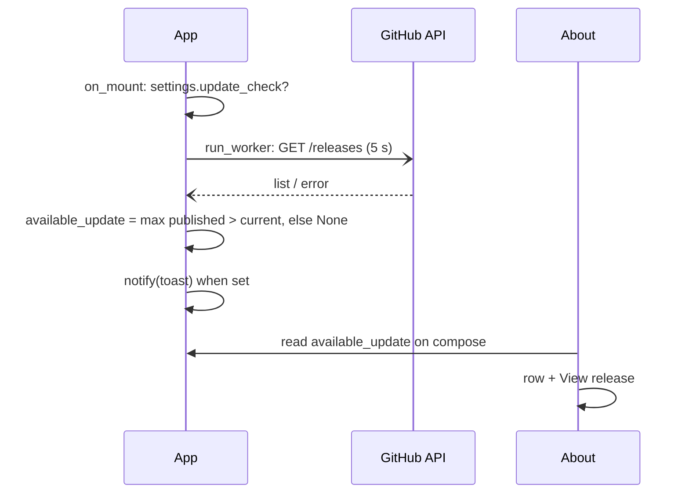

# Update notifications

Status: implemented (notification only; installation is a separate proposal,
see "Phase 2"). Beads: at-0dk.

## Problem

Users install a binary once and never hear about fixes. v0.2.1 patched a
listen-key leak and 0.3.0 adds error telemetry; nobody running 0.2.0 learns
either exists unless they revisit the GitHub page.

## Goal

On launch the app checks GitHub Releases once, off the UI thread. When a
newer published version exists it shows a bottom-right toast, and the About
dialog shows the available version with a **View release** link for the rest
of the session. Nothing is shown when up to date, when the check is off, or
when it fails.

## Non-goals

Downloading or installing anything (Phase 2), background polling, release
notes rendering, "skip this version" memory, a manual "check now" action,
a "you are up to date" indicator, PyPI publishing (a separate distribution
improvement; not a prerequisite here).

## Tech stack

| Option | Verdict | Why |
|---|---|---|
| Textual built-in | none exists | `textual` 8.2.7 ships no update/version-check facility; `app.notify` is the toast |
| `tufup` 0.10 (TUF) | rejected | an update *framework*: signing keys, metadata repo, its own install step. Disproportionate for a version check; revisit for Phase 2 only if GitHub-hosted assets prove insufficient |
| PyUpdater | rejected | archived |
| **Own checker on the GitHub Releases API** | **chosen** | `httpx` (via the SDK), `packaging` already in the tree; one unauthenticated `GET`, ~100 lines |

Infrastructure facts that shape the checker (verified against the repo):

- `.github/workflows/release-binaries.yml` creates a **draft prerelease**;
  the maintainer publishes it by hand. Drafts are invisible to the
  unauthenticated API, so a published release is the only thing the checker
  can see. Automated tests use mocked responses; a smoke test against a real
  published release is a manual step.
- Every release so far is a prerelease, so `GET /releases/latest` 404s. The
  checker lists releases and selects the maximum itself.
- Unauthenticated rate limit: 60 requests/hour per IP. One request per
  launch.

## Design

### Data

| Datum | Purpose | Consumer | Lifecycle |
|---|---|---|---|
| `Settings.update_check: bool = True` | opt-out of the GitHub call (same posture as `telemetry`) | `App.on_mount` before scheduling the check; Settings > General toggle | replaced on toggle |
| `App.available_update: Release \| None` (in memory) | drives the toast and the About row | the toast once; `AboutScreen` on open | lives for the process; the next launch's check replaces it |

No "last checked" timestamp, no skipped-version memory, no cache.

### Module `addictune_cli/src/update.py`

```python
@dataclass(frozen=True)
class Release:
    version: Version
    html_url: str

async def check(client: httpx.AsyncClient, current: Version, *, prereleases: bool) -> Release | None
```

`check()` does `GET https://api.github.com/repos/ukw2d/addictune-cli/releases?per_page=30`
with `Accept: application/vnd.github+json`, `X-GitHub-Api-Version:
2022-11-28`, `User-Agent: addictune-cli/<ver>`, 5 s timeout. It parses each
`tag_name` with `packaging.version.Version` (skipping unparsable tags and
`draft == true`), drops prereleases when `prereleases` is false, and returns
the maximum when it is `> current`, else `None`. Any exception, non-2xx
status or malformed body → `None` after one DEBUG log line; never a Sentry
event.

**Prerelease policy:** the app passes `prereleases=True`. "Prerelease" means
PEP 440 (`0.4.0b1`), not GitHub's prerelease flag: every release here is
flagged beta on GitHub while its tag is a plain `vX.Y.Z`, so the flag carries
no signal for selection. The parameter exists so that once a `b`/`rc` tag
is published, stable users can stop being offered it by changing one literal
in `App.check_for_update`, not the selection logic. No per-user channel
setting.

Robustness required by review: a page of 30 covers the project's release
history for years; if the API returns an empty list or only older versions,
the result is `None`. The checker never looks at assets — Phase 2 owns
"is there a build for my platform".

### UI

Toast (`app.notify`, bottom-right, auto-dismiss; toasts cannot carry
buttons):

```
┌──────────────────────────────────────────┐
│ Update available                          │
│ addictune-cli 0.4.0 is out (you have     │
│ 0.3.0). Open About for the release page. │
└──────────────────────────────────────────┘
```

About dialog, new row between the links row and "Built with"; omitted when
`available_update` is `None`:

```
          GitHub · Report a bug · Releases · Support

          Update available: 0.4.0  ·  View release
```

`View release` opens `html_url` with the existing `screen.open_url` action.
The installed version row and the Releases link stay as they are.

Settings > General: "Check for updates on start" toggle under the telemetry
row, same style, description "Asks GitHub once per launch whether a newer
release exists. Sends no account data."

### Flow



## Acceptance

1. Newer published release → toast once per launch and the About row with
   that version; `View release` opens the release page.
2. No newer release → no toast, no row, no "up to date" text anywhere.
3. `update_check` off → no request is made (a `MockTransport` that fails on
   any call).
4. Network error, 403 rate limit, non-JSON body, tags that do not parse →
   no toast, one DEBUG line, no Sentry event; startup is not delayed.
5. Selection: drafts and unparsable tags skipped, equal/older ignored,
   prerelease filter honoured.
6. The check never blocks `on_mount` (worker) and the app quits cleanly
   while it is still in flight.

## Failure and rollback

Check failures are silent by design. Feature rollback: `update_check =
False` removes all network behaviour; removing `update.py`, the About row
and the toggle removes the feature with no data left behind.

## Validation

- Unit tests with `httpx.MockTransport` for every acceptance point above.
- Textual pilot test: toast text and About row when the check returns a
  release; no row when it returns `None`.
- Manual smoke, once 0.3.0 is published: run 0.2.1 against the real API and
  see the toast.
- `just check`, `uv run addictune --self-test`.

## Release plan

**0.3.0 ships this proposal.** An updater only helps once it is installed;
the check in 0.3.0 is what lets 0.3.0 users learn that 0.4.0 exists.

## Phase 2: installing the update (separate proposal, date open)

Not approved; recorded so the requirements are not lost. A future
`docs/design/auto-install.md` must answer, per channel:

- **Channel detection** that proves *how* the running copy was installed,
  not just that it is Nuitka-compiled: a `.pkg` install lives under
  `/usr/local/lib/addictune-cli/`; a `uv tool` install lives under `uv tool
  dir`. Anything else is "unknown — open the release page".
- **Asset contract**: the platform asset and `SHA256SUMS` exist for the
  offered release (a newer release may lack them); asset naming shared with
  `tools/package.py` under test; archives have an `addictune-cli/` root
  directory that extraction must strip.
- **Shutdown sequence** before any install: prepare → confirm the
  interruption with the user → stop playback and the player child
  (`PlaybackBar.on_unmount`) → flush settings and close HTTP
  (`App.on_unmount`) → install → restart. No `execv` from a button handler.
- **uv channel**: existing installs are `git+…` without a tag, so
  `uv tool upgrade` re-resolves `main` and PyPI publishing does not migrate
  them. The install step must pin the exact release
  (`--force git+…@v<ver>` or a PyPI version), run after shutdown, and verify
  the installed version before claiming success. Migration to PyPI needs
  consent.
- **macOS `.pkg`**: `open file.pkg` returns immediately and reports nothing.
  Label the action "Open installer"; the downloaded file is owned by the
  installer, so it lives in a well-known location and is removed on the
  next start, not on exit.
- **Linux / Windows directory swap**: two renames are not atomic; define the
  crash states, a readiness condition before deleting the old copy (the new
  binary started and reached the UI), rollback when the new binary fails to
  start, behaviour with a second running instance and with a stale staging
  dir, safe extraction (no path traversal), and the Windows helper process
  that waits for exit before swapping.
- **Authenticity**: `SHA256SUMS` beside the asset detects corruption only;
  the trust boundary is GitHub over HTTPS, the same as a manual download.
  Signing the sums (`minisign`) with an embedded public key is the upgrade
  path and should be decided in that proposal.
