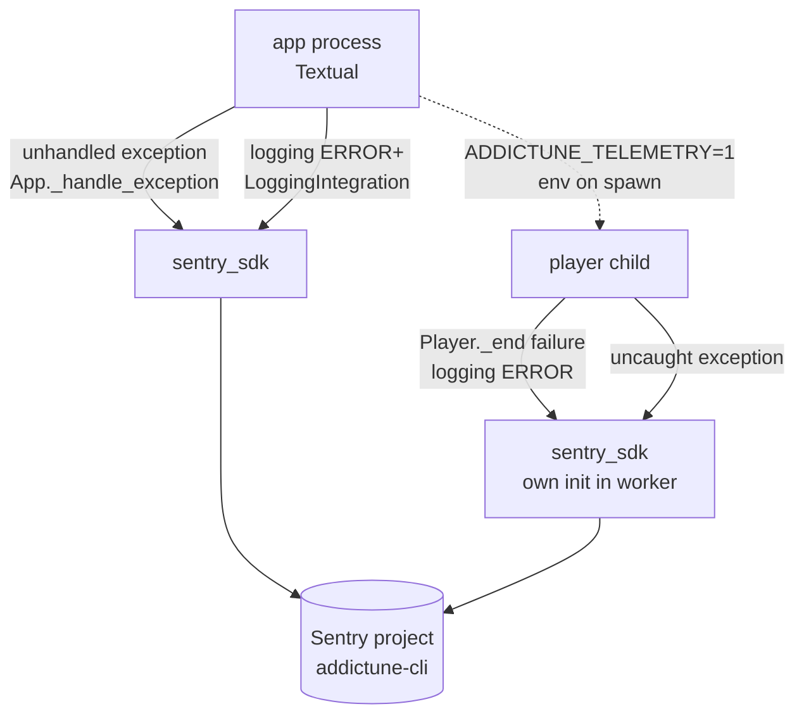

# Error telemetry (Sentry), opt-in

Status: proposal (awaiting approval). Beads: epic to be created on approval.
Covers requests #5 (central error store) and #6 (settings toggle).

## Problem

The first public bug report arrived as a screenshot of a toast. The maintainer
had no stack trace, no OS, no app version, no network stage, and the only log
is a file on the user's machine that they do not know exists. Every future
report will look the same unless errors reach the maintainer on their own.

## Goal

When a user has opted in, unexpected errors in the app and in the player
child reach a Sentry project where the maintainer can see: app version, OS,
Python/PyAV/FFmpeg versions, the failing stage and libav reason, the redacted
stream URL, and the recent log lines leading up to it -- without ever seeing
the user's email, tokens, listen key, IP, or password.

## Non-goals

- Performance tracing, profiling, session replay, metrics, crons. Errors only.
- Usage analytics ("which channels are popular"). Not an error, not sent.
- Server-side anything. Sentry SaaS, org `ukw2d`, one project.
- Sending the full `debug.log` file. Breadcrumbs cover the last 100 records.

## Decision: opt-in, default off

This is a terminal app that users install from GitHub. Default-on telemetry
would be a reputational problem in that audience and a GDPR problem for EU
users. The toggle lives in Settings > General, default `false`, and the
first launch after upgrade asks once:

```
┌───────────────────────────────────────────────────────────────┐
│  Help fix bugs?                                               │
│                                                               │
│  addictune can send anonymous crash and playback-error        │
│  reports to the developer (Sentry). A report contains the     │
│  app version, OS, the error and the recent log lines. It      │
│  never contains your email, password, tokens or IP address.   │
│  You can change this later in Settings > General.             │
│                                                               │
│                           [ No thanks ]   [ Send reports ]    │
└───────────────────────────────────────────────────────────────┘
```

The prompt is shown once (`telemetry_prompted: bool` setting) after login
succeeds, never before -- login failures must not be gated behind a dialog.

Settings > General row (see `account-tier.md` for the full panel):

```
│  Telemetry                                                     │
│  [x] Send anonymous error reports (Sentry)                     │
│      Reports contain the app version, OS and the error;        │
│      never your email, tokens or IP.                           │
```

## Design

### Data

| Datum | Purpose | Consumer | Lifecycle |
|---|---|---|---|
| `Settings.telemetry: bool = False` | the user's consent | `telemetry.init()` at app start and at toggle time; worker child reads it from env | replaced on toggle |
| `Settings.telemetry_prompted: bool = False` | show the consent dialog once | `app.on_mount` after first successful auth | set once; never cleared |
| Sentry events (remote) | the maintainer's debugging | Sentry UI | Sentry retention (90 days on the free plan) |

No other persistence. No local event queue: if Sentry is unreachable the SDK
drops the event; the local `debug.log` remains the fallback.

### Where it hooks in



One module `addictune_cli/src/telemetry.py`:

```python
def init(role: str, enabled: bool) -> None
```

- Returns immediately when `enabled` is false -- `sentry_sdk` is not even
  imported, so the opt-out path has zero cost and zero network.
- `sentry_sdk.init(dsn=DSN, release=f"addictune-cli@{version}",
  environment="dev" if running from source else "release",
  send_default_pii=False, max_breadcrumbs=100, traces_sample_rate=None,
  auto_session_tracking=False, server_name="", before_send=_scrub,
  integrations=[LoggingIntegration(level=INFO, event_level=ERROR)],
  default_integrations=True, auto_enabling_integrations=False,
  shutdown_timeout=2)`.
  The DSN is a public key by design (it can only ingest), so it is a constant
  in the module, not a secret.
- `_scrub(event, hint)` runs `redact_url` over every string in the event
  (message, exception values, breadcrumb messages, log params) and drops
  `server_name`, `user`, local variables (`include_local_variables=False`).
  The existing `_SECRET_PARAMS` list is the single source of truth for what
  counts as a secret; this feature adds `email` and `password` to the
  scrubber's key denylist through `EventScrubber(denylist=...)`.
- Tags set once: `role` (app/player), `os`, `python`, `pyav`, `ffmpeg`
  (`av.library_versions`), `network` (station slug), `installed_from`
  (nuitka/source). Nothing per user.
- Context set on playback: `playback.content_type`, `playback.stage`
  (resolve / open / decode / device) and the redacted URL -- this is the one
  thing the Reddit report lacked.

Textual: `App._handle_exception` is the funnel for every unhandled exception
in handlers and workers; the app subclass overrides it to call
`sentry_sdk.capture_exception` before delegating. The player child has no
Textual; `sentry_sdk`'s default `excepthook` and `threading` integrations
cover its decode thread, and `Player._end` already logs at ERROR, which the
logging integration turns into an event with the breadcrumb trail.

The child learns the consent from the environment: `PlayerClient._spawn`
adds `ADDICTUNE_TELEMETRY=1` when enabled; the child calls
`telemetry.init("player", os.environ.get(...) == "1")`. Toggling in Settings
re-inits the app side immediately and restarts the child only when it is
idle (same rule `Player.devices()` already uses).

### Packaging

- `sentry-sdk>=2.72` as a regular dependency (`uv add sentry-sdk`); it is
  pure Python with `urllib3`/`certifi`, ~1 MB in the Nuitka bundle.
- Nuitka: `--include-package=sentry_sdk` plus `certifi` data; verify in the
  `--self-test` smoke that `telemetry.init("app", False)` and `True` with a
  bogus DSN both pass.
- CI: tests run with telemetry disabled; one test runs `init(True)` against
  `sentry_sdk.transport` replaced with a recording transport and asserts the
  scrubber removed a planted token, email and IP.

### Sentry project setup (maintainer, one-time)

Sentry's "set up with your coding agent" flow installs a plugin
(`npx @sentry/agent-plugin install ukw2d#...`) that mainly configures the
agent's MCP access to the Sentry API and scaffolds `sentry_sdk.init`. For a
40-line integration in one module the scaffold adds nothing we would keep,
and the plugin would live in the agent config, not in this repo. Proposal:
create the project `addictune-cli` (platform Python) in org `ukw2d` by hand,
paste the DSN into `telemetry.py`, set the release on tag push via
`SENTRY_RELEASE`-free approach (the app sets `release` from
`importlib.metadata.version`). The agent plugin can be installed later if the
maintainer wants Sentry issue lookup from the editor; it is not a dependency
of this feature.

### Privacy text

README "Accounts and privacy" gains a "Error reports" paragraph: what is
sent, what is never sent, where the toggle is, link to the scrubber source.
`.github/release-notes.md` mentions the opt-in prompt.

## Acceptance

- Fresh install: no network traffic to `sentry.io` until the user accepts
  the one-time prompt or flips the toggle (verified with a recording
  transport in tests and by a `tcpdump`-free check: `sentry_sdk` not in
  `sys.modules`).
- With telemetry on, a forced playback failure produces one Sentry issue
  containing: release, OS, role=player, stage, libav reason, redacted URL,
  the last log lines; and NOT containing the planted email, listen key,
  audio_token, auth, member_id, IP.
- Toggle off stops events immediately (app) and at the next idle (child).
- `just check`, `--self-test`, and the Nuitka package smoke pass with the new
  dependency on all three OSes (CI matrix).

## Failure / rollback

- Sentry unreachable: SDK drops events silently; app is unaffected
  (background thread, 2 s shutdown drain cap).
- Scrubber bug: `before_send` exceptions are caught by the SDK and the event
  is dropped, not sent raw.
- Rollback: remove the two settings keys from the model (unknown keys are
  already ignored on load), remove the dependency.

## Validation

- `tests/test_telemetry.py`: disabled => no import; enabled => recording
  transport; scrubber contract on a synthetic event with every secret class.
- `tests/test_settings.py`: new keys default false; round-trip.
- Manual: one real event from a source run to the Sentry project before
  tagging.
