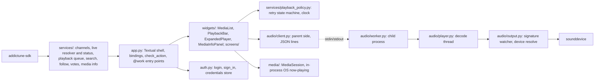

# Trim and rewrite of addictune-cli

Status: **`01`–`05` and `07b` landed on `develop` (2026-10-07); `06` was done by the separate SDK agent (0.4.1); `07` is withdrawn (D12).** Work goes epic by epic; each finished epic gets an overview and owner approval before the next starts.

Written 2026-10-06 from six read-only module reviews (audio, media session, auth/settings/packaging, app shell, widgets and lists, SDK), then revised the same day after the owner's first round of answers (section 3 marks them as *owner*). Line numbers in module docs come from those reviews; spot-check before acting on one. This folder is the single source of context for the rewrite. Beads is the only tracker; these docs are specs, not task lists.

**Paths in the module docs are dated snapshots.** After the last tidy (2026-10-07) `tui/controllers/` and `tui/handlers/` no longer exist (their modules live in `tui/services/`; `controllers/playback.py` became `services/playback_policy.py`) and the only stylesheet is `tui/styles/app.tcss`. Section 4 below is the current layout.

Companion: [`../debugging-playback.md`](../debugging-playback.md) (how to read the two-process playback log).

## 1. Product, in one paragraph

`addictune` is a Textual terminal player for the AudioAddict networks (DI, RadioTunes, RockRadio, JazzRadio, ClassicalRadio, ZenRadio). The user browses channels, mixshows, playlists and (planned) tracks, plays one stream, sees what is on now (live show, track, next show), votes and follows, searches, and controls playback from the OS media keys and now-playing widget. It is used daily by one person. It is not a library, not a server and not a multi-user app.

## 2. Size

| Area | Before (2026-10-06) | Target | Landed (2026-10-07) |
|---|---|---|---|
| Audio (child process, protocol, player, output, stream, playback controller, clock) | about 1,100 | about 600 | 1,466 (the stream probe/ICY reader and hotplug stayed; `01` Landed shape explains) |
| Channels stay streams (`07b`): matcher trim | 1,330 | — | 513 |
| OS media session | 893 | about 350 | 567 (MPRIS D-Bus interface boilerplate) |
| Auth, settings, paths, logging, entry | about 700 | about 350 | 418 |
| App shell (app, services, handlers, controllers, screens) | about 5,300 | about 2,000 | 5,179 (includes the 513 channels/live code above) |
| Widgets, lists, styles | about 4,900 | about 2,100 | 2,665 |
| Packaging `tools/` + `justfile` | about 900 | about 200 | 265 |
| **Production total** | **12,092** | about 5–5.5k | **10,323** (py + tcss) |
| Tests | 9,471 | about 4k | 8,412 |

The LOC targets were set before the module reviews and missed by a wide margin on the shell, audio and tests: the owner ruled that no daily-used behaviour may be dropped (D15), the three channel-live services were kept as streams (D12 withdrawn), and most tests pin behaviour the owner relies on. What the rewrite removed is the duplicated plumbing (four list layers, 60 app forwarders, mirrored reactives, two protocols, per-OS packaging scripts, session cache, legacy paths), which was the goal; the remaining size is feature code.

## 3. Decisions bound to the rewrite

Marked **proposed** until the owner confirms. Open questions in section 9 feed these.

| # | Decision | Status | Consequence |
|---|---|---|---|
| D1 | Playback stays in a **separate process**. In-process audio made the UI laggy and the isolation is architecturally right. The protocol, device handling and `Player` inside it are rewritten. | owner | `01` keeps `worker`/`client` pair, deletes the text protocols, watchdog, signals and duplicate counters. Orphan safety is stdin EOF, which works on all three OSes. |
| D2 | Users **can change audio settings**: device (or system default), sample rate, latency. `audio_dtype` is deleted because the decoder ignores it today. Settings apply live through a `configure` command; no restart. | owner | The hotplug bug is fixed by an output-signature watcher in the child (see `01`). The device list comes from the child so the picker never goes stale. |
| D3 | One generation counter, owned by `Player` in the child and echoed on every event. | landed (01) | Replaces the duplicate counters in the handler, controller and bar. |
| D4 | OS media session runs in-process unless the macOS spike (`02`) fails. | owner (spike approved) | A macOS-only child stays only if pumped run-loop callbacks do not survive idle. |
| D5 | No class exists only to forward a call. `app.py` has no one-line forwarders; services do not reach into `app` privates. | landed (03) | Removes about 60 forwarders in `app.py` and the forward layer in `services/`. |
| D6 | One generic `MediaList[T]` driven by a `ListSpec[T]` replaces the four-layer `LazyList` stack. | landed (04) | About 920 LOC becomes about 150. |
| D7 | One frozen `NowPlaying` value is the only playback state the UI reads. Bar and expanded player are two views of it. | **not built**: `PlaybackBar` stays the single owner of now-playing state and the expanded player is a pure view of it (04 Landed shape) | Deletes 15 mirrored reactives and 13 bar messages. |
| D8 | Built objects are never copied-and-patched (`model_copy`, `dataclasses.replace`). Data is built once. | fixed (global rule) | `TrackQueue`, `ModelItem.set_followed`, settings save, `play_resolved` are redesigned. |
| D9 | The CLI uses only the public SDK surface. No `client._session_keys` and similar. | landed (05b) | The SDK gains public login and session APIs (see `06`); auth and shell wait for the bumped version. |
| D10 | One config/cache root via `platformdirs`, one app name. | landed (05a) | Replaces four locations under two names. |
| D11 | No data is persisted without a production reader (global rule). | fixed | Volume, theme, audio settings are kept. Anything else needs a stated consumer. |
| D12 | ~~Channels play as tracklists~~ **Withdrawn 2026-10-06 (owner).** Per-track playback would tie the CLI to the account's server-side current track and interfere with listening on several devices; channels stay a plain ICY stream any player can consume. Replaced by **`07b`**: keep the stream, trim the ICY-to-routine matcher to one `LiveResolver`. | owner | `07` is withdrawn; `07b` runs before `03`/`04` on branch `07b-channels-stream`. ICY stays for good. |
| D13 | **Linux, macOS and Windows are all supported.** Windows is untested so far; every module lists its Windows gaps. | owner | `01` needs a Windows default-endpoint read; `02` keeps SMTC; `05` adds a Windows manual test pass and keeps the Windows CI job. |
| D14 | SDK changes are done by a **separate agent**. `06` is the request list; CLI epics that depend on it wait for the version bump. | owner | Order of work puts SDK-dependent epics last. |
| D15 | **No functionality is reduced by default.** Code is removed only when it is duplicated or makes no sense. Filters, settings, playback control, search, expanded player, global search, recently-played, keyring, media keys all stay. | owner | Every "DELETE" in a module doc must name the duplicate or the dead path it removes; a visible feature is never a candidate. |
| D16 | **One shared player queue.** `TrackQueue` plus a refillable source (`PlaylistSource`, `EpisodeSource`; `RoutineSource` added by `07`) is the single queue for every tab. *Next* behaves the same for every queue; *previous* exists for queues (playlists, mixshow episodes, tracks) and never for channels, which are a live stream. | owner | `03` builds it; `04` renders it; `07` only adds a source. |
| D17 | `01`–`05` are built on branch **`develop`**. `07` later gets its own branch off `develop`. | owner | No code change on `main` until the owner merges. |

## 4. Shape (as landed, 2026-10-07)



Package layout (sizes are the landed line counts; `py + tcss` = 10,323):

```
addictune_cli/
  __main__.py, src/subprocess_worker.py   39   Nuitka re-exec dispatch for the audio child
  src/main.py, logging_setup.py          135   keep
  src/paths.py                            20   platformdirs, one app name
  src/auth.py                            129   login / sign_in / credentials (keyring or 0600 file)
  src/settings.py                         95   single in-memory instance, debounced save
  src/audio/                           1,249   state 8, protocol 124, client 194, worker 118,
                                               player 312, output 149, stream 344
  src/media/                             567   session, macos, linux, windows
  src/tui/app.py                         740   shell: bindings, check_action, 14 @work shells
  src/tui/ (support modules)             485   presentation, types, palettes, utils, caches, typed_nodes, command_palette
  src/tui/services/                    3,320   channels, live_resolver, live_status, live_shows, playback,
                                               playback_policy, queue, follow, votes, search, media_info,
                                               features, auth, following (filters), image_loader, images, clock
  src/tui/widgets/                     2,080   lists, playback bar, expanded player, media info, small leaves
  src/tui/screens/                       955   settings, global search, list options, episodes, auth, station
  src/tui/styles/app.tcss                509   the only .tcss; screens carry their own DEFAULT_CSS
tools/package.py + justfile              265
```

What differs from the plan written on 2026-10-06 (`main.py` keep, `auth.py ~70`, `settings.py ~60`, `stream.py ~150`, `output.py ~80`, `player.py ~130`, `worker.py` + `client.py ~160`, `media/ ~350`, `app.py ~250`, `services/ ~1,200`, `widgets/ ~1,300`, `screens/ ~800`, tools `~200`; total about 5k to 5.5k), and why:

| Plan | Landed | Reason it was not reachable |
|---|---|---|
| `stream.py ~150` "ICY removed by 07" | 344 | D12 withdrawn: channels stay ICY streams, so the reader, stall detection and title parsing stay. |
| `output.py ~80`, `player.py ~130`, `worker`+`client ~160` | 149, 312, 312 (+124 `protocol.py`) | Device picker with live reconfigure (D2), hotplug signature for three OSes, volume filter, generation echo. |
| `media/ ~350` | 567 | Three backends (D13); MPRIS needs about 120 lines of required D-Bus properties. |
| `auth.py ~70`, `settings.py ~60` | 129, 95 | Keyring backend choice that survives Nuitka plus the 0600 file store; validate-the-whole-batch `set()`. |
| `app.py ~250` | 740 | Only `App`/`Widget` can host `@work`, and every key and message handler must be on the app: 78 methods, a 78-line `BINDINGS` table, `check_action`. |
| `services/ ~1,200`, `widgets/ ~1,300` | 3,320, 2,080 | Not additive with the plan: `controllers/` and `handlers/` were folded into `services/` (2026-10-07), and D12/D15 kept the live resolver, status poller, filters/sort for three tabs, info panel, expanded player and artwork caches. |
| `screens/ ~800` | 955 | Kept screens (D15). |
| total about 5k to 5.5k | 10,323 | The original estimate assumed channels as tracklists (D12), a smaller feature set (D15) and no framework cost. |

Further trimming would mean removing features the owner uses or hiding line counts behind indirection; neither is in scope. `playback_bar.py` (655) is the one file that is still larger than it should be.

## 5. Contracts between modules (as landed)

```python
# audio/client.py (01)
class PlayerClient:
    def __init__(self, ..., on_state, on_error, on_position, on_info, on_title) -> None
    def play(self, url: str, *, live: bool, volume: float, start_at: float = 0.0) -> int  # generation
    def pause(self) -> None; def resume(self) -> None; def stop(self) -> None
    def seek(self, seconds: float) -> None
    def set_volume(self, volume: float) -> None
    def configure(self, config: OutputConfig) -> None       # live reopen, no restart
    def request_devices(self, on_devices: Callable[[list[str]], None]) -> None
    def close(self) -> None
    # child events arrive on the Textual loop, already filtered by generation

# media/session.py (02)
@dataclass(frozen=True)
class MediaInfo: title; artist; artwork_url; playing; can_play; can_pause; can_next; can_previous
class MediaSession(Protocol):
    def start(self, on_command: Callable[[Command], None], schedule: Schedule) -> None
    def update(self, info: MediaInfo) -> None
    def stop(self) -> None

# auth.py (05b)
async def login(client, email, password, network) -> int          # stores credentials after the server accepts
async def sign_in(client, network) -> int | None                   # silent login from the stored record
def is_auth_failure(exc) -> bool
```

Exact signatures are in each module's "Landed shape".

## 6. Module verdicts and order of work

| Order | Module | Verdict | Doc |
|---|---|---|---|
| 1 | Audio (done 2026-10-06) | KEEP process; REWRITE protocol, `player`, `devices`; DELETE handler | [01-audio.md](01-audio.md) |
| 2 | OS media session | REWRITE macOS; TRIM session and Linux; KEEP Windows; DELETE host | [02-media-session.md](02-media-session.md) |
| 3 | Settings, logging, packaging (no SDK dependency; landed 2026-10-06) | TRIM settings; REWRITE packaging | [05-auth-settings-packaging.md](05-auth-settings-packaging.md) |
| 4 | App shell (landed 2026-10-06) | REWRITE | [03-app-shell.md](03-app-shell.md) |
| 5 | Widgets and lists (landed 2026-10-06) | REWRITE lists and players; TRIM media info; KEEP leaves | [04-widgets-and-lists.md](04-widgets-and-lists.md) |
| 6 | Auth (after the SDK bump) | REWRITE on the public SDK API | [05-auth-settings-packaging.md](05-auth-settings-packaging.md) (section Auth) |
| ext | SDK request list for the separate agent (out of this repo's scope) | n/a | [06-sdk.md](06-sdk.md) |
| 1b | Channels stay streams: trim the ICY-to-routine matcher (landed 2026-10-06) | TRIM | [07b-channels-stream.md](07b-channels-stream.md) |
| x | ~~Channels as tracklists~~ withdrawn (D12) | n/a | [07-channels-as-tracklists.md](07-channels-as-tracklists.md) |

Why this order: `01` fixes the hotplug pain point and defines the `PlayerClient` contract. `02` removes the second subprocess. Settings and packaging have no SDK dependency, so they go before the shell. `03` precedes `04` because `app.py` defines the `NowPlaying` reactive that widgets render. Auth is last because it waited for the SDK bump (0.4.1); it landed as `05b`.

Revised order after `01` (owner, 2026-10-06): **01 ✓ → 07b → 02 → 05a → 03 → 04 → 05b.** `07b` goes before the shell and widgets so they start from one small `LiveResolver` instead of porting the 520-line matcher. `02` and `05a` are independent of it.

### Working rule: one epic, one module

- Work exactly one epic at a time, in the order above.
- An epic is finished only when its module is in target state: old code deleted, obsolete tests deleted, remaining tests updated, entry points switched, and the module doc has a **Landed shape** section.
- Edit only the epic's module. A change another module needs is recorded as a task under that module's epic and not applied. Tests outside the module may go red and stay red until their own epic runs; the doc's Landed shape lists them.
- A finished epic gets a review agent pass and owner buy-in before the next epic starts.
- The last epic runs the aggregate minimalism review (global mandatory gate).
- `01`–`05` run on `develop` (D17). `07b` runs on `07b-channels-stream` off `develop` and merges back after owner approval.
- Modules that are good enough are kept: `audio/state.py`, `services/clock.py`, `services/playback_policy.py` (light trim), `playback_format`, `marquee_text`, `content_type_label`, `live_show_badge`, `live_show_follow`, `app_footer`, `logging_setup.py`, `main.py`, thin screens (dialog, episodes, station_select, auth).

## 7. Non-goals

- No new features. Listen history (`add-cav`, `add-frv`) is **not wanted now** (owner, 2026-10-06); the Tracks tab keeps Liked tracks and offers a History view that is only a placeholder (section 9, item 2).
- No plugin system, no alternate audio backends behind a protocol.
- No history, versioning or retention of settings or credentials.
- No change to visible behaviour the owner uses daily (D15). Channels keep playing as live streams (D12 withdrawn).
- No SDK edits from this repo's agent (`06` is a request list).

## 8. Validation gates

Per module epic:

- `uv run pytest` green for the module and its retargeted tests.
- `uv run ruff check` and the project's type check clean on touched files.
- Grep acceptance from the module doc returns empty.

Manual, before closing specific epics:

- `07b`: one hour on a channel: ICY title, vote, elapsed from the routine offset, artwork, live-show badge and "Next:" at a show boundary all behave as today.
- `01`: play, connect headphones. Audio moves within about 2 seconds without restart; unplug and it moves back. Pick a named device in settings and it switches at once. Quit is immediate; `kill -9` of the parent leaves no child.
- `02`: media keys play/pause/next work after the app sits idle for 30 minutes. Now-playing shows title, artist and artwork (if kept).
- `05`: fresh config dir login works; relaunch restores the session; bad password shows the error banner; `just package` produces the macOS `.pkg`.
- **Windows pass** (D13): once per epic that touches audio, media or packaging, run the app on a Windows machine or VM: play, device switch, media keys, settings, quit. Record the result in the module doc.
- Final epic: aggregate minimalism review by a spawned sub-agent, then commit.

## 9. Open questions, prioritised

Answered 2026-10-06, first round (moved into section 3): in-process player (no, D1), audio settings (keep, D2), ICY (replaced by `07`, D12), Windows (required, D13), SDK (external agent, D14), macOS spike (approved, D4), artwork cache (keep disk + memory, option A in [`04`](04-widgets-and-lists.md#artwork-options)), `07` probe (passed; see Probe results in `07`).

Answered 2026-10-06, second round (owner). Module docs carry the same answers.

1. **`07` skip/advance**: moot, `07` withdrawn; channels are not skippable in the CLI (they are a stream).
2. **Tracks tab / history**: the Tracks tab stays and shows **Liked tracks by default**; its options menu (`^F`) has a **View** group with a **History** entry that shows only a placeholder until listen history is built (owner, 2026-10-07; `add-cav`, `add-frv` stay open for the real feature). A first attempt removed the tab entirely; it was reverted the same day.
3. **Expanded player**: keep.
4. **Next/previous**: *next* works the same for every queue; *previous* for queues, never for live channels (D16).
5. **Playlists "Followed" filter**: must work. Implemented with the SDK's `playlists.iter_followed(user_id, ...)` and `Playlist.following`.
6. **Keyring**: keep.
7. **Packaging**: Nuitka builds for **all three** platforms, and `uv tool install` is an equally valid install path. Neither is dropped.
8. **Global search**: keep as a screen.
9. **Recently-played history** in the info panel: keep, limited to the last 5 tracks (a bounded list that advances as tracks change, not a TTL).
10. **Linux named device hotplug**: accept (pause/resume picks up a named device plugged in later).
11. **Functionality**: no reduction by default (D15).
12. **Shared queue** across tabs: yes (D16).

## 10. Relationship to existing Beads work

- `add-cav` (Tracks view and filter options) and `add-frv` (Tracks tab for history and favorites) stay open; the rewrite only gave the Tracks tab the shared options menu (View: Liked tracks / History placeholder) so the real history can plug into it later.
- Epics created 2026-10-06: one epic per module, children per task list, dependencies in the order of section 6. The `07` epic (`add-3uw`) is **closed as withdrawn**; `07b` has its own epic.

## 11. Process rules

- One epic in progress at a time.
- Commits go to the current branch regularly. No push, merge or publish without asking.
- Epic completion needs validation evidence, then owner buy-in. The aggregate minimalism review by a spawned sub-agent runs once, at the end of the last epic.
- Sub-agent prompts for review must exclude `nuitka-crash-report.xml`, `uv.lock`, `build/`, `dist/` and `.venv`. One review of `nuitka-crash-report.xml` already overflowed a reviewer's context.
